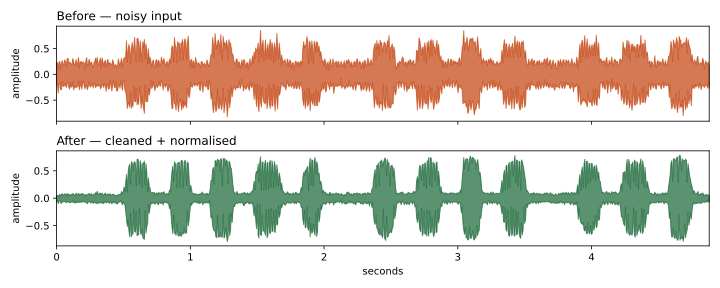

# Local Audio Enhancer 🎙️


[](https://github.com/mrabr381/local-audio-enhancer/actions/workflows/ci.yml)
[](https://www.python.org/)
[](LICENSE)
[](#how-it-works)

**Clean a noisy voice recording on your own computer — free, no upload,
no account, no per-minute fees.** Paid enhancers charge per minute or per
month; this one costs nothing and your audio never leaves your machine.

> **Try it now — web app (1-click deploy):** share.streamlit.io →
> Create app → repo `mrabr381/local-audio-enhancer`, branch `main`, file
> `app.py` → Deploy. Upload a file, listen before/after, download the
> cleaned audio. No live demo link yet — Pages is not enabled on this repo.
> Numbers below are from the real sample run: [sample report page](sample_output/index.html).

## Before / after (measured, not assumed)

Sample: synthetic voice-like syllables + white noise, rumble and 50 Hz
hum (fully synthetic — no real person's voice). Measured with ffmpeg
`loudnorm` (ITU-R BS.1770), verified 2026-11-20:

| Measurement | Before | After |
|---|---|---|
| Integrated loudness | −15.45 LUFS | **−15.99 LUFS** (target −16) |
| Noise floor | −20.22 dBFS | **−30.54 dBFS** (−10.32 dB) |
| True peak | −1.36 dBFS | −1.95 dBFS (no clipping) |
| Duration | 4.88 s | 4.88 s (nothing cut — see below) |
| RMS level | −15.44 dBFS | −15.32 dBFS |



Word-preservation check: in voiced regions the enhanced audio correlates
**0.975** with the known-clean reference, and gap (between-words) RMS
fell from 0.099 to 0.033 — noise went down, words stayed.

The sample's 0.5 s lead-in is loud noise, not silence, so the trimmer
correctly left it alone (duration unchanged). Trimming was verified
separately: a 6.88 s file padded with 1 s of digital silence at each end
came out at 4.42 s — exactly the content span plus the 80 ms padding.

Note: there are no before/after audio files in this repo — audio files
are binary and cannot be pushed through the usual GitHub workflow, so
the numbers above and the waveform are the record. Regenerate the
sample audio locally with `python scripts/make_sample.py`, then listen
to it yourself.

## Quickstart

```bash
git clone https://github.com/mrabr381/local-audio-enhancer.git
cd local-audio-enhancer
python -m venv .venv && source .venv/bin/activate
pip install -r requirements.txt

# 1. Regenerate the sample (audio files are binary and are not in the repo)
python scripts/make_sample.py

# 2. Enhance it
python -m audio_enhance --input sample_data/noisy.wav --out sample_output/

# 3. Your own recording
python -m audio_enhance --input my-voice.mp3 --out report/ --target-lufs -16 --format mp3
```

Options: `--target-lufs` (default −16, podcast standard; −14 suits
music-adjacent content), `--no-denoise`, `--no-trim`,
`--format wav|mp3`.

## How it works

**Load** (WAV via scipy; MP3/M4A/OGG/FLAC via ffmpeg) → **trim silence**
(frames below noise floor + 12 dB, 80 ms padding kept) → **spectral noise
reduction** (STFT, noise profile from the quietest frames, max −18 dB
gating) → **loudness normalisation** (gain from ffmpeg loudnorm's
integrated LUFS, capped at ±30 dB, tanh soft-limiter keeps true peak
under −1 dBFS) → **report** (Markdown + waveform SVG + waveform CSV,
all measured values, nothing invented).

Requires Python 3.10+, **ffmpeg** (loudness measurement + MP3/M4A
in/out: `sudo apt install ffmpeg` · `brew install ffmpeg` ·
[ffmpeg.org/download.html](https://ffmpeg.org/download.html)), and the
pip packages in `requirements.txt` (numpy, scipy, matplotlib, streamlit).

## What it produces

- **`*_enhanced.wav` / `.mp3`** — the cleaned audio.
- **`report.md`** — before/after loudness, peak, RMS, noise floor.
- **`waveform.svg` + `waveform.csv`** — before/after waveform as an
  image and as text data, so anyone can check the numbers without the
  binary audio.

## Honest limitations

- **No human listening test.** Quality was verified with numbers
  (noise floor −10.32 dB, voiced correlation 0.975, no clipping),
  not by ear — listen before using it for anything important.
- **Spectral gating, not AI.** Stationary noise (hiss, hum, fan) drops
  a lot; sudden noises (door slams, keyboard clacks) mostly stay. No
  de-esser, no de-reverb.
- **Synthetic sample.** The demo voice is formant-synthesised syllables,
  not real speech — it proves the pipeline, not how it sounds on you.
- **ffmpeg needed** for loudness measurement and MP3 export (WAV works
  without it); without it the report falls back to a labelled RMS
  estimate. A 60-minute file takes a few minutes on a normal laptop.

Layout: `app.py` (Streamlit web app) · `audio_enhance/` (`cli.py`,
`io.py`, `measure.py`, `denoise.py`, `enhance.py`, `report.py`) ·
`scripts/make_sample.py` · `sample_data/` (regenerated locally, binary,
not in the repo) · `sample_output/` (real sample report + waveform
SVG/CSV + demo page) · `tests/` (pytest).

MIT — see [LICENSE](LICENSE). Issues and pull requests are welcome:
no invented numbers, every measurement reproducible with the commands
above, and every new feature covered by a test on the sample audio.
